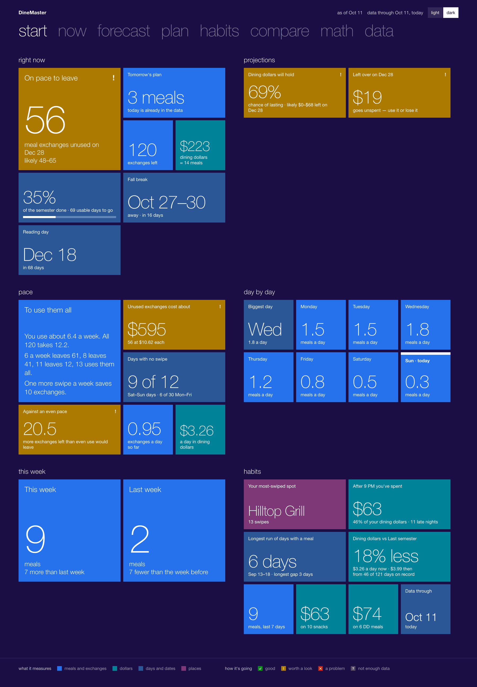
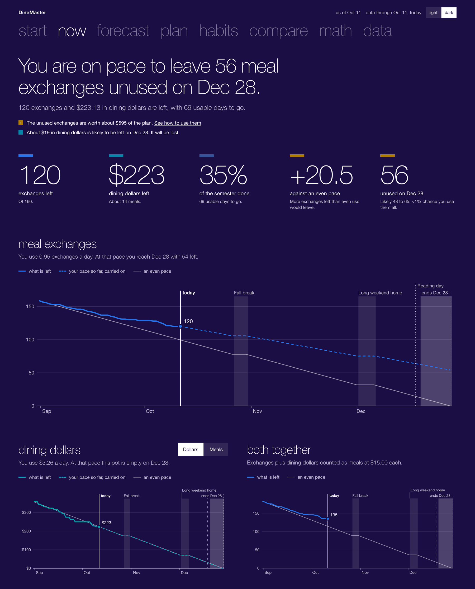
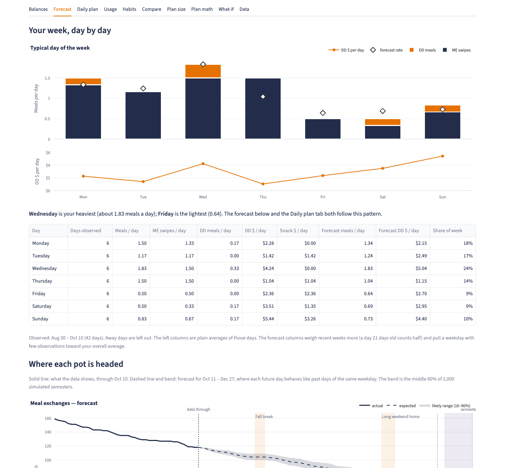
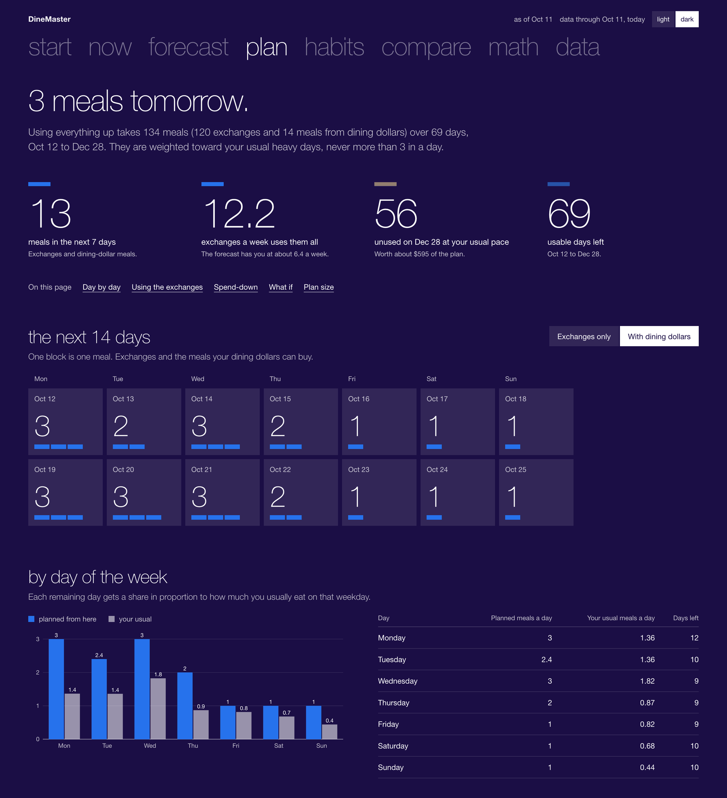
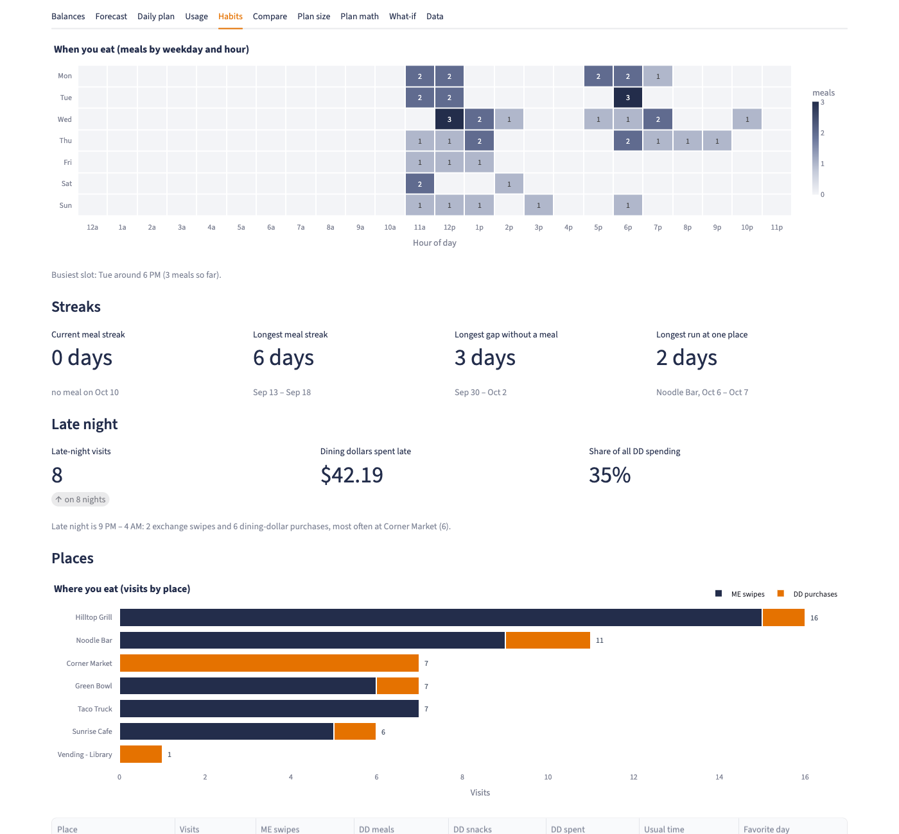

# DineMaster

A (very unnecessary) dashboard that runs on your own computer and answers two questions: **will my dining plan last the semester, and how much of it will I not use?**

Download your transaction history from the dining account website. Put the files in a folder. DineMaster then shows:

- the meal exchanges and dining dollars that remain
- if you are ahead of or behind an even pace
- the number of meals you can eat today
- the date when each balance will be empty, if that is a risk
- the number of meal exchanges that you will not use, and their cost

I made it for my UVA meal plan (meal exchanges and dining dollars), and I tested it only with that plan. You can change the plan size, the dates, and the file format in the settings. Thus it can work for a different school, but I did not try that.



*The screenshots show demo data that is not real.*

## What you get

**Start screen**: the home page. It is a summary in the style of Windows 8. Each tile gives one fact. Some tiles turn over and show a second fact. Click a tile to open the section that has the details.

The tiles follow the forecast. If you are safe but many meal exchanges will expire, the tiles show the unused exchanges, the weekly rate that uses them all, and the days of the week on which you do not swipe. If a balance can become empty before the end, the tiles show the run-out dates again.

**Sections**: charts and details on seven pages. The names at the top of each page open them.

| Section | Contents |
|---|---|
| now | Your balances through time compared with an even pace, the meals for each day and each week, and the places you eat |
| forecast | A projection of each balance with a probable range, and your usual week |
| plan | The number of meals to eat each day for the next two weeks, the exchanges that stay unused at each weekly rate, the result of a meals-per-day rate that you select, and each plan that your school sells |
| habits | The times and places you eat, streaks, late-night purchases, and a weekly summary |
| compare | This semester compared with earlier semesters |
| math | The result of each formula, with and without your days away |
| data | The files that the app imported, possible problems, your settings, and your calendar |



**Themes**: the app has a dark theme and a light theme. The switch is at the top right of each page. The app keeps your selection.

**Color key**: each color has one meaning. The key at the bottom of each page shows the meaning of each color.

<details>
<summary>More screenshots</summary>

**Forecast, in the light theme**


**Plan**


**Habits**


</details>

## Try the demo

Install [uv](https://docs.astral.sh/uv/getting-started/installation/). This tool installs Python and all other necessary software. Then do these commands in a terminal:

```bash
git clone https://github.com/LoganBradley787/dinemaster.git
cd dinemaster
uv run python demo/make_demo.py
DINEMASTER_CONFIG=demo/config.toml uv run python -m dinemaster
```

A browser tab opens at `http://localhost:8160`. It shows a semester of demo data. To stop the app, press `Ctrl+C` in the terminal.

## Use your own data

1. **Set your plan.** Open `config.toml` in a text editor. The file contains my plan as an example. Change these values:
   - `start` and `end`: your first day and last day on campus this semester
   - `starting_me` and `starting_dd`: the meal exchanges and dining dollars at the start of the plan
   - `meal_price`: the approximate price of a meal when you pay with dining dollars
   - `dd_rollover`: set this to `true` if dining dollars that you do not spend stay in your account for the next semester
   - `price` and `dd_in_price` (optional): the price of the plan, and the dining dollars that the price includes. With these values, DineMaster shows the cost of the exchanges that you do not use.
   - `[[plans]]` (optional): the plans that your school sells. The plan page uses them.
   - `[[away.periods]]`: the days when you are away. Delete this entry if it does not apply.
2. **Download your transactions.** Go to the dining account website. Open the statement for each account. Export each statement as a CSV file. You can use any date range.
3. **Put the files in the project.** Make a folder with the name `raw-data` in the project folder. Put the CSV files in it. Do not change the file names. DineMaster uses the names to identify the accounts.
4. **Start the app.**

   ```bash
   uv run python -m dinemaster
   ```

   A browser tab opens at `http://localhost:8160`.

### Update your data

Download new exports at any time. Put them in `raw-data` with the old files. Then reload the page.

DineMaster counts each transaction only one time, even if it is in more than one file. Old data stays in the app. The top of each page shows the last date that your data includes. The data page shows the number of new transactions from each file.

All numbers are correct for the last day that your data includes. DineMaster does not count the days after it as days without meals. If the data is some days old, the daily plan assumes that you ate your usual meals on those days. If the data is more than seven days old, DineMaster tells you, and it does not show a plan for today.

### UVA only: download with one button

On the data page, the "Get new data" button logs in to the UVA dining site and downloads the CSV file for each account into `raw-data`.

It logs in with NetBadge and your UVA digital certificate (the one that was installed with eduroam), and it does not open a window. It opens a browser window only when the login needs you. Usually Duo is the reason: Duo trusts the browser for 30 days, and after that you approve it one time again. The data page tells you a few days before that happens.

The app also does this by itself. When you open a page and the last try is more than `auto_hours` old (4 by default), it gets new data in the background. The top bar then says "updating", and the page reloads when the data is new. If the login needs you, the top bar says "update needs you", and you press "Get new data" one time.

The button works only with the UVA dining site. The address and the account numbers are in the `[export]` section of `config.toml`, and they are mine. If your account numbers are different, change them. If you are not at UVA, delete the `login_url` line. The button then goes away, and you download the files yourself. To stop the automatic updates, set `auto_hours = 0`. If you log in with a password, delete `cert_button`.

The button uses Google Chrome with its own profile in `data/browser-profile`. Your everyday Chrome is not changed. In that profile, Chrome can send your certificate to `virginia.edu` sites without asking (`cert_sites`). Your password and your certificate stay with Chrome. DineMaster does not read them or keep them.

### Optional: add your calendar

Make a folder with the name `calendar`. Put `.ics` calendar files in it. Most calendar apps can export this file type.

DineMaster uses events with names such as "break", "recess", "home", or "trip" as days away. It shows reading days and exams as marks on the charts. You can set each event to off on the data page.

## Your data stays on your computer

DineMaster runs on your computer and sends no data to other computers. The app listens only on your own computer. Thus other computers on your network cannot open it. It connects to the dining site only when you click "Get new data", or by itself when you open the app and `auto_hours` is set. It connects to a calendar feed only if you put the address of the feed in `config.toml`. Git ignores the folders `raw-data/`, `data/`, and `calendar/`. Thus you cannot commit or push your personal data by accident.

## Settings

The default settings are in `config.toml`. Each line has a comment.

You can also change the plan, the dates, and your days away on the data page. The data page saves your changes to a local file, `data/settings.json`. It does not change `config.toml`. Git ignores the local file. To go back to the values in `config.toml`, click "Reset to config.toml" on the data page.

On the data page, you can also set an "as of" date to see a past day.

If your school uses a different export format, change the `[files]` section. It sets the column names and the file names. The `[classification]` section sets the difference between a snack and a meal. Its `adjustment_patterns` list identifies the changes that the dining office makes to a balance, which are not purchases. The `[tiles]` section can show or hide the run-out tiles at all times.

## For developers

```bash
uv run pytest -q
```

The code is in `dinemaster/`:

- `ingest.py` merges the exports into one ledger.
- `metrics.py` calculates the pace.
- `forecast.py` and `budget.py` calculate the projections and the daily plan.
- `tiles.py` makes the tiles of the Start screen.
- `palette.py` holds every color and its meaning.
- `web/` holds the pages, the templates, and the chart kit. The chart kit draws each chart as SVG.

## License

MIT. See [LICENSE](LICENSE).
